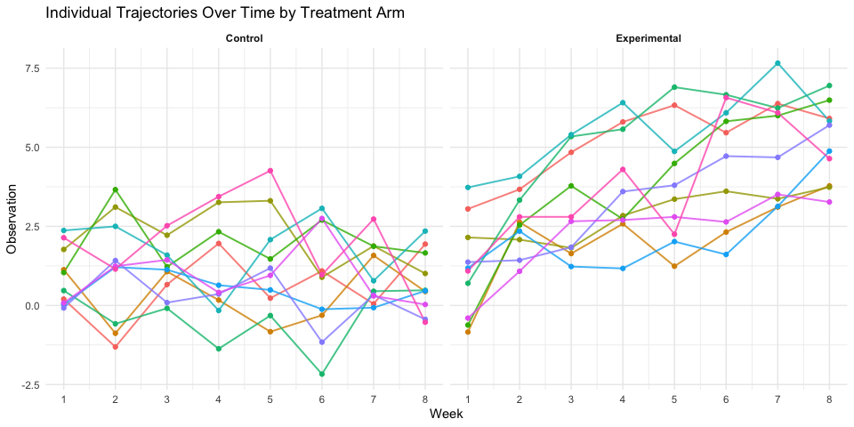

p8105_hw5_zg2627
================
Zimu Guan
2026-11-17

## Problem 1

``` r
# Set birthday function
birthday_sim = function(n) {
  birthdays = sample(1:365, size = n, replace = TRUE)
  any(duplicated(birthdays))
}
```

``` r
set.seed(123)

# Estimate the probability for each group size using 10,000 simulations
birthday_results = 
  tibble(group_size = 2:50) |>
  mutate(
    probability = map_dbl(
      group_size,
      \(n) mean(replicate(10000, birthday_sim(n)))
    )
  )

birthday_results
```

    ## # A tibble: 49 × 2
    ##    group_size probability
    ##         <int>       <dbl>
    ##  1          2      0.0033
    ##  2          3      0.0079
    ##  3          4      0.0158
    ##  4          5      0.0248
    ##  5          6      0.0387
    ##  6          7      0.057 
    ##  7          8      0.0749
    ##  8          9      0.0885
    ##  9         10      0.116 
    ## 10         11      0.140 
    ## # ℹ 39 more rows

``` r
# Plot the estimated probability of a shared birthday by group size
birthday_results |>
  ggplot(aes(x = group_size, y = probability)) +
  geom_line(color = "steelblue", linewidth = 1) +
  geom_point(color = "steelblue", size = 1.5) +

  # Add a reference line at 50% probability
  geom_hline(
    yintercept = 0.5,
    linetype = "dashed",
    color = "gray50"
  ) +

  # Customize labels and axis scales
  labs(
    title = "Probability of a Shared Birthday by Group Size",
    x = "Group Size",
    y = "Probability of Shared Birthday"
  ) +
  scale_x_continuous(breaks = seq(0, 50, 5)) +
  scale_y_continuous(
    labels = scales::percent_format(accuracy = 1),
    limits = c(0, 1)
  ) +
  theme_minimal()
```

<!-- -->

The simulation results show that the probability of at least two people
sharing a birthday increases as group size increases. With 10 people,
the estimated probability is 11.60%, while with 23 people, it reaches
50.67%, exceeding 50% despite the relatively small group size. As the
group size increases further, the probability rises to 70.88% for 30
people and 97.10% for 50 people. These findings illustrate the birthday
paradox, demonstrating that shared birthdays become likely even in
moderately sized groups.

## Problem 2

``` r
# List all CSV files in the data directory
file_names = list.files(
  path = "data",
  pattern = "\\.csv$",
  full.names = TRUE
)

# Check the number of files and inspect their names
length(file_names)
```

    ## [1] 20

``` r
head(file_names)
```

    ## [1] "data/con_01.csv" "data/con_02.csv" "data/con_03.csv" "data/con_04.csv"
    ## [5] "data/con_05.csv" "data/con_06.csv"

``` r
# Inspect the structure of an individual participant's data
example_subject = read_csv(file_names[1], show_col_types = FALSE)

glimpse(example_subject)
```

    ## Rows: 1
    ## Columns: 8
    ## $ week_1 <dbl> 0.2
    ## $ week_2 <dbl> -1.31
    ## $ week_3 <dbl> 0.66
    ## $ week_4 <dbl> 1.96
    ## $ week_5 <dbl> 0.23
    ## $ week_6 <dbl> 1.09
    ## $ week_7 <dbl> 0.05
    ## $ week_8 <dbl> 1.94

``` r
head(example_subject)
```

    ## # A tibble: 1 × 8
    ##   week_1 week_2 week_3 week_4 week_5 week_6 week_7 week_8
    ##    <dbl>  <dbl>  <dbl>  <dbl>  <dbl>  <dbl>  <dbl>  <dbl>
    ## 1    0.2  -1.31   0.66   1.96   0.23   1.09   0.05   1.94

``` r
# Create a dataframe of file names and read each participant's data
longitudinal_files =
  tibble(file_name = file_names) |>
  mutate(
    subject_data = map(
      file_name,
      \(file) read_csv(file, show_col_types = FALSE)
    )
  )

# Inspect the resulting dataframe and list-column
glimpse(longitudinal_files)
```

    ## Rows: 20
    ## Columns: 2
    ## $ file_name    <chr> "data/con_01.csv", "data/con_02.csv", "data/con_03.csv", …
    ## $ subject_data <list> [<spec_tbl_df[1 x 8]>], [<spec_tbl_df[1 x 8]>], [<spec_t…

``` r
# Extract subject IDs and treatment arms from file names
longitudinal_data =
  longitudinal_files |>
  mutate(
    file_id = basename(file_name),
    arm = case_when(
      str_starts(file_id, "con") ~ "Control",
      str_starts(file_id, "exp") ~ "Experimental"
    ),
    subject_id = str_extract(file_id, "\\d+")
  ) |>

  # Expand the participant data stored in the list-column
  unnest(subject_data) |>

  # Convert weekly observations from wide to long format
  pivot_longer(
    cols = starts_with("week_"),
    names_to = "week",
    values_to = "observation"
  ) |>
  mutate(
    week = as.integer(str_remove(week, "week_")),
    arm = factor(arm, levels = c("Control", "Experimental"))
  ) |>

  # Keep only the variables needed for analysis
  select(subject_id, arm, week, observation) |>
  arrange(arm, subject_id, week)

# Check the dimensions and structure of the tidy dataset
dim(longitudinal_data)
```

    ## [1] 160   4

``` r
glimpse(longitudinal_data)
```

    ## Rows: 160
    ## Columns: 4
    ## $ subject_id  <chr> "01", "01", "01", "01", "01", "01", "01", "01", "02", "02"…
    ## $ arm         <fct> Control, Control, Control, Control, Control, Control, Cont…
    ## $ week        <int> 1, 2, 3, 4, 5, 6, 7, 8, 1, 2, 3, 4, 5, 6, 7, 8, 1, 2, 3, 4…
    ## $ observation <dbl> 0.20, -1.31, 0.66, 1.96, 0.23, 1.09, 0.05, 1.94, 1.13, -0.…

``` r
head(longitudinal_data)
```

    ## # A tibble: 6 × 4
    ##   subject_id arm      week observation
    ##   <chr>      <fct>   <int>       <dbl>
    ## 1 01         Control     1        0.2 
    ## 2 01         Control     2       -1.31
    ## 3 01         Control     3        0.66
    ## 4 01         Control     4        1.96
    ## 5 01         Control     5        0.23
    ## 6 01         Control     6        1.09

``` r
# Plot individual trajectories over time for each treatment arm
longitudinal_data |>
  ggplot(
    aes(
      x = week,
      y = observation,
      group = subject_id
    )
  ) +
  geom_line(
    aes(color = subject_id),
    linewidth = 0.7,
    alpha = 0.8
  ) +
  geom_point(
    aes(color = subject_id),
    size = 1.5
  ) +

  # Display control and experimental groups separately
  facet_wrap(~ arm) +

  # Customize labels and plot appearance
  scale_x_continuous(breaks = 1:8) +
  labs(
    title = "Individual Trajectories Over Time by Treatment Arm",
    x = "Week",
    y = "Observation",
    color = "Subject ID"
  ) +
  theme_minimal() +
  theme(
    legend.position = "none",
    strip.text = element_text(face = "bold")
  )
```

<!-- -->

The spaghetti plot shows distinct longitudinal patterns between the
control and experimental groups. In the control group, observations
fluctuate over the eight weeks without a clear overall increasing or
decreasing trend. In contrast, most subjects in the experimental group
exhibit an upward trajectory, with observations generally increasing
over time. By the later weeks, observations in the experimental group
tend to be higher than those in the control group. Although individual
variability is present in both groups, the experimental group
demonstrates a more pronounced positive trend, suggesting a possible
effect of the experimental intervention.

## Problem 3

``` r
# Simulate one dataset and perform a one-sample t-test
sim_t_test = function(mu, n = 30, sigma = 5) {

  # Generate observations from a normal distribution
  sample_data = rnorm(n, mean = mu, sd = sigma)

  # Test the null hypothesis that the population mean is zero
  test_result = t.test(sample_data, mu = 0)

  # Extract the estimated mean and p-value
  broom::tidy(test_result) |>
    select(estimate, p.value)
}
```

``` r
# Set a random seed to ensure reproducible simulation results
set.seed(123)

# Run 5,000 simulations for each true population mean
simulation_results =
  tibble(true_mu = 0:6) |>
  mutate(
    simulation = map(
      true_mu,
      \(mu) map_dfr(
        1:5000,
        \(i) sim_t_test(mu = mu)
      )
    )
  ) |>

  # Combine all simulation results into a single dataframe
  unnest(simulation) |>
  mutate(
    reject_null = p.value < 0.05
  )

# Inspect the simulation results
dim(simulation_results)
```

    ## [1] 35000     4

``` r
glimpse(simulation_results)
```

    ## Rows: 35,000
    ## Columns: 4
    ## $ true_mu     <int> 0, 0, 0, 0, 0, 0, 0, 0, 0, 0, 0, 0, 0, 0, 0, 0, 0, 0, 0, 0…
    ## $ estimate    <dbl> -0.23551878, 0.89169168, 0.12210196, -0.46944466, -0.91790…
    ## $ p.value     <dbl> 0.79442040, 0.25166939, 0.87884916, 0.57503703, 0.38848756…
    ## $ reject_null <lgl> FALSE, FALSE, FALSE, FALSE, FALSE, FALSE, FALSE, FALSE, FA…

``` r
head(simulation_results)
```

    ## # A tibble: 6 × 4
    ##   true_mu estimate p.value reject_null
    ##     <int>    <dbl>   <dbl> <lgl>      
    ## 1       0   -0.236   0.794 FALSE      
    ## 2       0    0.892   0.252 FALSE      
    ## 3       0    0.122   0.879 FALSE      
    ## 4       0   -0.469   0.575 FALSE      
    ## 5       0   -0.918   0.388 FALSE      
    ## 6       0    0.769   0.379 FALSE
