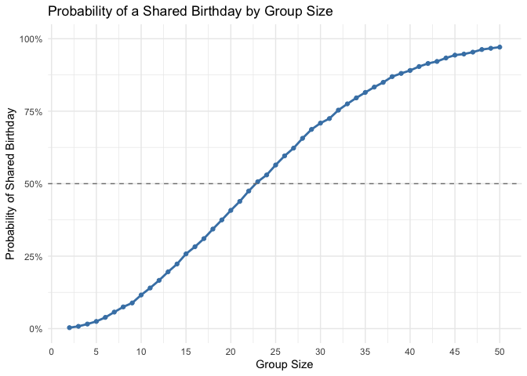

p8105_hw5_zg2627
================
Zimu Guan
2026-11-17

## Problem 1

``` r
# Set birthday function
birthday_sim = function(n) {
  birthdays = sample(1:365, size = n, replace = TRUE)
  any(duplicated(birthdays))
}
```

``` r
set.seed(123)

# Estimate the probability for each group size using 10,000 simulations
birthday_results = 
  tibble(group_size = 2:50) |>
  mutate(
    probability = map_dbl(
      group_size,
      \(n) mean(replicate(10000, birthday_sim(n)))
    )
  )

birthday_results
```

    ## # A tibble: 49 × 2
    ##    group_size probability
    ##         <int>       <dbl>
    ##  1          2      0.0033
    ##  2          3      0.0079
    ##  3          4      0.0158
    ##  4          5      0.0248
    ##  5          6      0.0387
    ##  6          7      0.057 
    ##  7          8      0.0749
    ##  8          9      0.0885
    ##  9         10      0.116 
    ## 10         11      0.140 
    ## # ℹ 39 more rows

``` r
# Plot the estimated probability of a shared birthday by group size
birthday_results |>
  ggplot(aes(x = group_size, y = probability)) +
  geom_line(color = "steelblue", linewidth = 1) +
  geom_point(color = "steelblue", size = 1.5) +

  # Add a reference line at 50% probability
  geom_hline(
    yintercept = 0.5,
    linetype = "dashed",
    color = "gray50"
  ) +

  # Customize labels and axis scales
  labs(
    title = "Probability of a Shared Birthday by Group Size",
    x = "Group Size",
    y = "Probability of Shared Birthday"
  ) +
  scale_x_continuous(breaks = seq(0, 50, 5)) +
  scale_y_continuous(
    labels = scales::percent_format(accuracy = 1),
    limits = c(0, 1)
  ) +
  theme_minimal()
```

<!-- -->

The simulation results show that the probability of at least two people
sharing a birthday increases as group size increases. With 10 people,
the estimated probability is 11.60%, while with 23 people, it reaches
50.67%, exceeding 50% despite the relatively small group size. As the
group size increases further, the probability rises to 70.88% for 30
people and 97.10% for 50 people. These findings illustrate the birthday
paradox, demonstrating that shared birthdays become likely even in
moderately sized groups.
